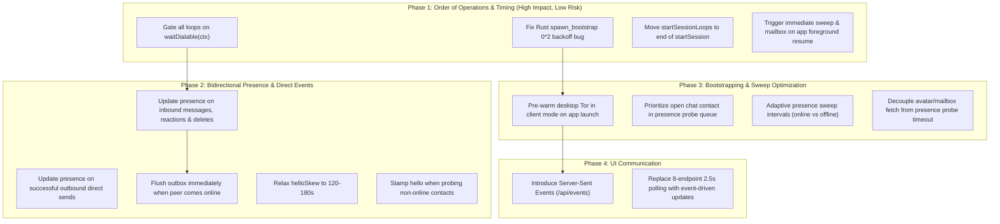

# Audit & Investigation: Bootstrapping, Device Online Transitions & Presence in Molepipe

This document provides a comprehensive technical audit of how a Molepipe device bootstraps, transitions to an online state, discovers peer presence, announces its own presence to others, and manages the order of operations across its backend, Tor layer (Arti), and frontend UI.

---

## Executive Summary & System Overview

In Molepipe, a device's identity and account number is its **Tor v3 onion address** (`<pubkey_base32>.onion`), derived deterministically from a 24-word BIP39 seed via SLIP-0010 ($m/0'/0'$ for Ed25519 signing, $m/0'/1'$ for X25519 agreement). 

Because communication is peer-to-peer over onion services, becoming "online" is fundamentally a **two-phase state**:

```
+---------------------------------------------------------------------------------------------------+
|                                      DEVICE ONLINE TIMELINE                                       |
+---------------------------------------------------------------------------------------------------+
| [ Cold Start / Prewarm ]                                                                          |
|   |-- Starts TorClient / downloads network directory consensus & active guard circuits           |
|                                                                                                   |
| [ Unlock (PIN / Password) ]                                                                       |
|   |-- Decrypts identity.enc & messages.enc                                                        |
|   |-- Derives keys & initializes in-memory session                                                |
|                                                                                                   |
| [ Phase 1: Outbound Ready -> Dialable() == true ]  (~0.5s - 15s)                                  |
|   |-- Tor client can build outbound circuits to peer onion services                               |
|   |-- Can SEND messages, probe contacts, fetch mailboxes, and emit presence hellos                |
|   \-- Device is NOT yet reachable inbound by peers dialing its .onion address                     |
|                                                                                                   |
| [ Phase 2: Inbound Ready -> Ready() == true ]     (~25s - 4+ min)                                 |
|   |-- Introduction points established on relays                                                   |
|   |-- Hidden service descriptor signed and uploaded to HSDir authorities                          |
|   \-- Peers can now dial this device directly at its .onion address                               |
+---------------------------------------------------------------------------------------------------+
```

### Key Findings Matrix

| Finding / Area | Severity | Current Behavior | Impact | Recommended Fix |
|---|---|---|---|---|
| **Rust `spawn_bootstrap` Backoff Bug** | **High** | `delay = (delay * 2).min(MAX_DELAY)` where `delay = Duration::ZERO`. | `0 * 2 = 0`. If Tor bootstrap fails, it spins in a tight loop with 0ms sleep, burning mobile CPU. | Initialize `delay` to `Duration::from_secs(1)` or use `max(Duration::from_secs(1), delay * 2)`. |
| **Premature Loop Execution** | **High** | Outbox (5s), Mailbox (15s), Accept (15s), Sync (20s) use blind timers; don't wait for `Dialable()`. | If Tor takes >15s to bootstrap, early attempts fail, wasting attempt counts. Mailbox backs off for 60s, delaying offline message arrival to 75s. | Gate all background loops on `waitDialable(ctx)` and trigger them immediately when dialable. |
| **No Desktop Tor Pre-warming** | **Medium** | Desktop (`cmd/desktop`) only starts Arti *after* unlock; Android pre-warms on app start. | Desktop users always pay full 10-25s cold Tor bootstrap after entering their password. | Pre-warm `arti proxy` in client mode on desktop app launch before unlock. |
| **Missed Presence on Direct Traffic** | **Medium** | Direct inbound messages (`POST /p2p/message`), reactions, deletes do not update sender presence. | Bob can be actively chatting with Alice, but Bob's dot in Alice's UI remains grey/red until next 30s sweep. | Call `hookPeerOnline(sender)` on every authenticated inbound direct request. |
| **Outbound Sends Don't Update Presence** | **Low** | Successful direct delivery via `sendV2` marks message delivered, but leaves recipient presence stale. | Successfully dialing a contact proves they are online, but local presence dot doesn't turn green. | Update `s.presence[to] = presenceOnline` immediately upon successful direct send. |
| **Outbox Not Triggered by Presence** | **Medium** | When a peer transitions to `online`, the outbox is not notified. | Queued messages sit waiting up to 20s for the next periodic outbox tick even though peer is known online now. | Trigger immediate queue flush `s.flushOutboxFor(peer)` when peer comes online. |
| **Strict 60s Clock Skew Window** | **Medium** | Presence hello stamp rejects timestamps if $|ts - now| > 60s$. | Clock drift between mobile devices or Tor latency jitter causes silent hello rejection (`rollupHelloReject`). | Broaden freshness window to 120s-180s combined with replay cache. |
| **Heavy Unprioritized Sweeps** | **Low** | `probeAllContacts` probes all contacts in random map order with 8 workers every 30s. | Causes circuit build spikes. The active conversation peer might be probed last instead of first. | Prioritize currently open chat contact; use adaptive backoff for long-offline peers. |
| **App Resume Stale Presence** | **Medium** | On Android `onResume()`, `Backend.setDormant(false)` wakes Arti, but loops sleep on timers. | User returns to app from background and sees stale presence and missed messages for up to 30s. | Expose `TriggerSweep()` / `Wake()` called on app foreground resume and pull-to-refresh. |
| **UI Polling Overhead** | **Low** | Webview polls 8 separate HTTP endpoints every 2.5s (`refreshAll`). | 192 HTTP requests/min to loopback; up to 2.5s delay to see presence changes. | Consolidate endpoints or introduce Server-Sent Events (SSE) `/api/events` for instant push. |

---

## 1. Deep Dive: Bootstrapping & Device Online State

### 1.1 The Two-Phase Online Model

Tor v3 onion services operate with an inherent asymmetry between dialing out and receiving connections:
- **`Dialable()`**: Outbound circuit capability. Arti has downloaded directory consensus, connected to guard nodes, and can build 3-hop circuits to rendezvous points. This completes in **~0.5s to 2s** on a warm client, or **~5s to 15s** on a cold start.
- **`Ready()`**: Inbound reachability. Arti has selected 3 introduction points, established circuits to them, derived and blinded its descriptor keys, signed the descriptor, and uploaded it to the HSDir ring authorities across the Tor network. On desktop this takes **~25s to 45s**; on mobile networks it routinely takes **1 to 4+ minutes**.

```mermaid
sequenceDiagram
    autonumber
    actor User
    participant UI as Webview UI
    participant Backend as Go Backend
    participant Tor as Arti (Tor Engine)
    participant HSDir as Tor HSDir Ring
    participant Peer as Peer Contact

    User->>UI: Launch App
    Note over UI,Backend: Android prewarms StartClient(); Desktop idle
    User->>UI: Enter Password / PIN
    UI->>Backend: POST /api/unlock
    Backend->>Backend: Decrypt identity & chatstore
    Backend->>Backend: Spawn background startOnion()
    Backend-->>UI: 200 OK {account_number, session_token}
    UI->>UI: show("unlocked"), begin 2.5s poll
    
    rect rgb(235, 245, 255)
    Note over Backend,Tor: Phase 1: Tor Bootstrap
    Tor->>Tor: Connect to guards & download consensus
    Tor-->>Backend: Dialable() == true (send-ready)
    Backend->>Backend: presenceLoop unblocks
    Backend->>Peer: GET /p2p/profile?from=self&sig=... (Presence Hello)
    Peer-->>Backend: Returns Profile (Peer is ONLINE)
    Peer->>Peer: Marks self as ONLINE via Hello!
    end

    rect rgb(245, 255, 235)
    Note over Tor,HSDir: Phase 2: Descriptor Publication
    Tor->>Tor: Build intro points
    Tor->>HSDir: Upload v3 Onion Descriptor
    HSDir-->>Tor: Descriptor Accepted
    Tor-->>Backend: Ready() == true (inbound reachable)
    Backend->>Backend: Stop sending presence hellos (announcing = false)
    end
```

### 1.2 Platform Divergence: Android vs. Desktop

| Feature | Android (`mobile/mobile.go` + `torhost`) | Desktop (`cmd/desktop` + `torsidecar`) |
|---|---|---|
| **Runtime Model** | In-process Rust crate (`torhost`) via cgo and Tokio multi-thread runtime. | Child process: `exec.Command("arti", "proxy", ...)`. |
| **Pre-warming** | **Yes**: `Mobile.start()` triggers `go h.Prewarm()` and `go h.StartClient()`. Consensus downloads while user looks at lock screen. | **No**: Arti is not executed until `finishUnlock()` runs after user enters password. |
| **Warm Re-unlock** | **Fast path**: TorClient stays alive on lock. `startServiceLocked()` only launches the onion service (~1-8s). | **Process restart**: Unless within lock-grace window, kills child Arti process and spawns fresh one. |
| **State Introspection** | **Detailed**: Reads `State::Running`, `DegradedUnreachable`, `Bootstrapping`, `Problem` cause chains via C-ABI. | **Log scraping only**: Greps stderr for `"reuploading descriptor"` and `"Sufficiently bootstrapped"`. |
| **Dormant Mode** | **Supported**: Toggles `DormantMode::Soft` on `onStop()`, `DormantMode::Normal` on `onStart()`. | Not applicable. |

### 1.3 The Rust Exponential Backoff Bug in `torhost`

In [`torhost/src/lib.rs`](file:///home/admin/Documents/Github/molepipe/torhost/src/lib.rs#L176-L196):

```rust
fn spawn_bootstrap(client: Arc<TorClient<PreferredRuntime>>) {
    tokio::spawn(async move {
        let mut delay = Duration::ZERO;
        const MAX_DELAY: Duration = Duration::from_secs(60);
        loop {
            if client.bootstrap_status().ready_for_traffic() {
                return;
            }
            match client.bootstrap().await {
                Ok(()) => return,
                Err(e) => {
                    log::warn!("arti bootstrap failed (retrying in {:?}): {e}", delay);
                    tokio::time::sleep(delay).await;
                    delay = (delay * 2).min(MAX_DELAY);
                }
            }
        }
    });
}
```

> [!CAUTION]
> **Defect**: `delay` is initialized to `Duration::ZERO`. In Rust, `Duration::ZERO * 2` is still `Duration::ZERO`. As a result, if the initial bootstrap attempt fails (e.g. device is offline, in airplane mode, or switching networks), the loop sleeps for 0 seconds and immediately retries in a tight spin loop, burning CPU and generating log noise until network connectivity returns.

**Fix**:
```rust
let mut delay = Duration::from_secs(1);
// or:
delay = if delay.is_zero() { Duration::from_secs(1) } else { (delay * 2).min(MAX_DELAY) };
```

---

## 2. Deep Dive: Order of Operations Across Startup & Unlock

### 2.1 The Current Sequence in `finishUnlock` & `startSession`

In [`backend/internal/api/pin.go:135`](file:///home/admin/Documents/Github/molepipe/backend/internal/api/pin.go#L135-L193) and [`backend/internal/api/messaging.go:123`](file:///home/admin/Documents/Github/molepipe/backend/internal/api/messaging.go#L123-L216):

```
1. finishUnlock(w, id)
   |-- s.vault.unlock(id)
   |-- s.startSession(id)  [SYNCHRONOUS]
   |     |-- s.sessMu.Lock()
   |     |-- Allocates empty memory maps (s.contacts, s.messages, s.presence, etc.)
   |     |-- s.startSessionLoops(id)  <--- STARTS 10 BACKGROUND GOROUTINES HERE!
   |     |-- id.StoreKey()
   |     |-- s.chat.Load()  (reads messages.enc from disk)
   |     |-- s.adoptDataLocked(data)
   |     |-- s.sessMgr = s.newSessionManager()
   |     |-- s.ensurePrekeysLocked(id)
   |     \-- s.sessMu.Unlock()
   |-- Derives onionKey & preparedAliases
   |-- Returns HTTP 200 {account_number, session_token}
   \-- Spawns background goroutine:
         |-- s.startOnion(onionKey)
         |-- s.startPublishWatchdog(onionKey)
         \-- s.publishPreparedAliases(preparedAliases)
```

### 2.2 Flaw: Loops Started Before Store Data is Adopted

In `messaging.go:165`, `s.startSessionLoops(id)` is called **before** `s.chat.Load()` and `s.adoptDataLocked(data)`.
While `probeAllContacts` acquires `sessMu` for its contact list, other routines check variables like `s.mailboxURL` or device configs without synchronizing on store load completion. If `id.StoreKey()` fails or a version mismatch occurs (`ErrNewerVersion`), `startSession` aborts without persistence, leaving 10 background loops orphaned against an unpopulated session.

**Fix**: Move `s.startSessionLoops(id)` to the very end of `startSession()`, after `s.persistLocked()` and `s.peer.SetSessionManager(...)`.

### 2.3 Flaw: The Blind Timer Race on Background Loops

When `startSessionLoops` launches:
- `presenceLoop`: Waits on `s.waitDialable(ctx)` (polls every 500ms). Correct.
- `outboxLoop`: Waits `5s` (`outboxStartDelay`).
- `mailboxLoop`: Waits `15s` (`mailboxStartDelay`).
- `acceptRetryLoop`: Waits `15s` (`acceptRetryStartDelay`).
- `groupInviteRetryLoop`: Waits `15s` (`groupInviteRetryStartDelay`).
- `syncLoop`: Waits `20s` (`syncStartDelay`).
- `groupSyncLoop`: Waits `20s` (`groupSyncStartDelay`).
- `relayForwardLoop`: Waits `30s` (`relayForwardStartDelay`).

```
TIME ELAPSED AFTER UNLOCK:
0s -------- 5s -------- 10s -------- 15s -------- 20s -------- 30s -------- 75s
 |           |                        |            |
 |           +- outboxLoop fires      |            +- syncLoop fires
 |              (fails if Tor cold!)  +- mailboxLoop fires
 |                                       (fails if Tor cold!)
 |                                       Resets timer for +60s!
 |                                                                |
 |                                                                +- mailbox retries here!
 +-- Tor dialable at 16s (cold start) ----------------------------+
```

> [!WARNING]
> **Impact on User Experience**:
> 1. **Cold / Slow Tor Starts (>15s)**:
>    If Tor takes 16 seconds to bootstrap:
>    - `outboxLoop` fires at 5s $\rightarrow$ fails $\rightarrow$ increments attempt counter $\rightarrow$ sleeps for 20s.
>    - `mailboxLoop` fires at 15s $\rightarrow$ fails $\rightarrow$ resets timer for 60s. Offline messages waiting in the user's mailbox will not be fetched until **$15 + 60 = 75$ seconds** after unlock!
> 2. **Warm Tor Starts (<1s)**:
>    On a fast Android re-unlock or warm desktop, `Dialable()` is true in 0.6 seconds.
>    Yet `mailboxLoop` still waits **15 seconds** before fetching mail! `outboxLoop` still waits **5 seconds** before flushing!

**Fix**:
Every loop should use a unified dialable barrier:
```go
if !s.waitDialable(ctx) {
    return
}
// Run first tick immediately!
s.mailboxTick(ctx, id)
```

---

## 3. Deep Dive: Peer Presence & "Showing Others Online"

### 3.1 How the Presence Hello Works (and Why It's Needed)

When Alice comes online, she can dial out (`Dialable() == true`) within 1-5 seconds, but her onion descriptor won't be on the HSDirs for several minutes (`Ready() == false`).

To bridge this reachability gap, Molepipe implemented the **Presence Hello**:
When Alice probes Bob via `s.probeContact`, because `s.announcing()` is true (`!s.onion.Ready()`), Alice stamps her request:
$$\text{GET } /p2p/profile?from=\text{Alice}\&ts=T\&sig=\text{Ed25519}_{\text{Alice}}(T \parallel \text{Bob})$$

Bob receives this request, verifies the signature against Alice's public key, checks $|T - \text{now}| \le 60\text{s}$, verifies Alice is an accepted contact, and marks:
```go
s.presence[alice] = presenceOnline
s.helloAt[alice] = time.Now()
```
Bob keeps Alice marked online for `helloStickiness = 90 * time.Second`, even if Bob's own outbound probe to Alice fails because Alice's descriptor isn't published yet.

### 3.2 Flaws in Current Presence Flow

#### Flaw A: Stamping Stops Once `Ready()` is True
In [`backend/internal/api/presence.go:334`](file:///home/admin/Documents/Github/molepipe/backend/internal/api/presence.go#L334-L337):
```go
func (s *Server) announcing() bool {
    dev := s.currentDevice()
    return dev != nil && dev.IsPrimary() && s.onion != nil && !s.onion.Ready()
}
```
Once Alice's descriptor is published (`Ready() == true`), `announcing()` becomes **false**. Alice now sends **anonymous** `GET /p2p/profile` requests.
- **Problem**: Suppose Bob was offline when Alice unlocked. Bob comes online at $t = 60\text{s}$. Alice is already `Ready()`.
- Alice's sweep at $t = 60\text{s}$ probes Bob. Because Alice is `Ready()`, she does NOT include a hello stamp!
- Bob's server sees an anonymous profile request over Tor. Bob has no idea who requested it!
- Result: Bob does NOT learn Alice is online until Bob's independent 30s sweep happens to probe Alice.
- **Fix**: Stamp presence hellos whenever probing an accepted contact whose last known presence was `offline`, `unknown`, or `mailbox`, or whose hello is nearing expiry, regardless of `Ready()` status.

#### Flaw B: Direct Messaging Traffic Does Not Update Presence
When Bob sends Alice a message (`POST /p2p/message`), reaction (`POST /p2p/reaction`), or delete command (`POST /p2p/delete`), Bob dials Alice directly over Tor, authenticates with his Ed25519 signature, and delivers the payload.
- In [`backend/internal/api/messaging.go:634`](file:///home/admin/Documents/Github/molepipe/backend/internal/api/messaging.go#L634), `deliverMessage` appends the message and notifies the Android hook.
- **Crucial Omission**: It **never** updates `s.presence[sender]` or `s.helloAt[sender]`!
- If Alice had Bob marked as `offline` or `mailbox`, Bob stays marked `offline` or `mailbox` even while Alice is reading a message Bob just delivered seconds ago!
- **Fix**: Any authenticated direct peer transaction proves the peer is online. In `hookAllowMessage` or `deliverInboundLocked`:
  ```go
  s.presence[sender] = presenceOnline
  s.helloAt[sender] = time.Now()
  ```

#### Flaw C: Outbound Direct Delivery Does Not Update Recipient Presence
In [`backend/internal/api/outbox.go:174`](file:///home/admin/Documents/Github/molepipe/backend/internal/api/outbox.go#L174), `s.sendV2(...)` connects directly to `it.To` via Tor and delivers the message.
- If `sendV2` returns `nil` (success), `s.markDelivered(it.ID)` is called.
- `s.presence[it.To]` is **not updated**.
- Proving reachability by successfully delivering an E2E payload should immediately promote the recipient to `presenceOnline`.

#### Flaw D: Outbox Is Decoupled from Presence Flips
When Bob's hello arrives or Bob is probed online, `s.hookPeerOnline(bob)` sets `s.presence[bob] = presenceOnline`.
- If Alice has messages for Bob queued in `s.outbox`, they continue sitting in the outbox queue until the periodic `outboxLoop` timer fires (up to 20 seconds later).
- **Fix**: Add `s.flushOutboxFor(peerAccount)` inside `hookPeerOnline` and `probeContact` when a contact transitions to online.

> **Status: deferred, deliberately.** The queue-then-flush window is narrower than
> it looks: `deliverNow` already fires an immediate attempt off the request path
> (`messaging.go:1606`, `:1638`), so the only case a flush would rescue is a
> message queued while the peer was unreachable and the peer later coming back —
> worst case a 20s wait on the next tick.
>
> Against that, `outboxTick` has **no in-flight guard**: it snapshots every
> non-failed item each tick and can already double-send against a concurrent
> `deliverNow`. Adding a flush trigger multiplies the number of racing entry
> points, so a guard becomes a precondition — and a per-item guard has to be held
> across `sendDirectTimeout + mailboxDropTimeout` of network I/O, which puts a
> lock discipline spanning network calls into a file that has none today. That is
> a change to the outbox concurrency model, not a presence fix, and it deserves
> its own change with its own tests.
>
> Flaws B and C below/above deliver most of what D was reaching for anyway: a
> successful direct send now promotes the recipient, so the outbox and presence
> are no longer fully decoupled — the coupling just runs in the other direction.

#### Flaw E: Strict 60-Second Clock Skew Window
In [`backend/internal/protocol/protocol.go:620`](file:///home/admin/Documents/Github/molepipe/backend/internal/protocol/protocol.go#L620):
```go
const helloSkew = 60 * time.Second
```
If two mobile phones have clocks that differ by 61 seconds (common with manual time or network operator drift), or if Tor circuit latency exceeds 15 seconds during clock drift:
- Every hello is rejected as expired or in the future.
- The rejection is silent to the peer; `rollupHelloReject()` counts it.
- **Fix**: Expand `helloSkew` to `120s` or `180s`. The replay window is already protected by `p.recordHello(sig)`.

---

## 4. Deep Dive: Probe Sweep Inefficiencies & Ordering

### 4.1 Sweep Concurrency & Bottlenecks

In [`backend/internal/api/presence.go:142`](file:///home/admin/Documents/Github/molepipe/backend/internal/api/presence.go#L142-L180):
- `presenceWorkers = 8`
- `presenceTimeout = 10 * time.Second`
- `presenceInterval = 30 * time.Second`

```go
func (s *Server) probeAllContacts(ctx context.Context, id *identity.Identity) {
    s.sessMu.Lock()
    accts := make([]string, 0, len(s.contacts))
    for acct, c := range s.contacts {
        if c.Status == chatstore.StatusAccepted {
            accts = append(accts, acct)
        }
    }
    s.sessMu.Unlock()
    ...
```

1. **Random Map Iteration Order**: Go's `for acct := range s.contacts` randomizes iteration order. If a user has 15 contacts and is actively conversing with "Alice", Alice might be probed 15th while offline contacts consume the 8 worker slots.
2. **Serial Multi-Hop Inside Single 10s Budget**: Inside `probeContact`:
   - Step 1: `fetchProfileAnnouncing` (GET `/p2p/profile`)
   - Step 2: `FetchContactProfile` (POST `/p2p/contact-profile`)
   - Step 3: `FetchAvatar` (GET `/p2p/avatar`)
   All three execute sequentially over Tor within the same 10-second `pctx`. Over mobile Tor, three successive onion round-trips can exceed 10 seconds, causing context cancellation on step 3.
3. **Circuit Thundering Herd**: Firing 8 simultaneous onion dials every 30 seconds places high CPU and socket demand on mobile Tor / Arti.

---

## 5. Deep Dive: Frontend Polling vs. Push

In [`backend/internal/api/public/app.js:1093`](file:///home/admin/Documents/Github/molepipe/backend/internal/api/public/app.js#L1093-L1118):

```javascript
async function refreshAll() {
  if (!sessionToken) return false;
  const { ok, status, body } = await api("/api/identity");
  ...
  await Promise.all([
    loadProfile(),
    loadContacts(),
    loadGroups(),
    loadRequests(),
    loadGroupInvites(),
    loadMessages(),
    loadDesktop()
  ]);
  ...
}

function poll() {
  clearTimeout(pollTimer);
  pollTimer = setTimeout(async () => {
    if (!(await refreshAll())) return;
    poll();
  }, 2500);
}
```

### Analysis
- Every 2.5 seconds, the frontend sends **8 concurrent HTTP requests** to the Go backend (`/api/identity`, `/api/profile`, `/api/contacts`, `/api/groups`, `/api/requests`, `/api/group-invites`, `/api/messages`, `/api/desktop`).
- Even if no messages arrived and no presence changed, this creates **~192 HTTP requests per minute**.
- Each `/api/contacts` request iterates all contacts, calculates unread counts, and returns full JSON.
- Despite this polling frequency, when a contact comes online, there is a **0 to 2.5 second display lag** before the UI reflects the change.

---

## 6. Comprehensive Recommendations & Implementation Roadmap



---

### Phase 1: Order of Operations & Timing Fixes

#### 1. Fix `spawn_bootstrap` Backoff in `torhost/src/lib.rs`
```rust
// Replace:
let mut delay = Duration::ZERO;
...
delay = (delay * 2).min(MAX_DELAY);

// With:
let mut delay = Duration::from_secs(1);
...
delay = (delay * 2).min(MAX_DELAY);
```

#### 2. Gate All Background Loops on `waitDialable(ctx)`
In `mailboxloop.go`, `outbox.go`, `friendaccept.go`, `group.go`, `pair.go`:
```go
func (s *Server) mailboxLoop(ctx context.Context, id *identity.Identity) {
    if !s.waitDialable(ctx) {
        return
    }
    // Execute first tick immediately upon becoming dialable!
    s.mailboxTick(ctx, id)
    
    t := time.NewTicker(mailboxInterval)
    defer t.Stop()
    for {
        select {
        case <-ctx.Done():
            return
        case <-t.C:
            s.mailboxTick(ctx, id)
        }
    }
}
```

#### 3. Correct `startSession` Order of Operations
In [`messaging.go:165`](file:///home/admin/Documents/Github/molepipe/backend/internal/api/messaging.go#L165):
Remove `s.startSessionLoops(id)` from line 165.
Move `s.startSessionLoops(id)` to the very end of `startSession()` (line 216), after `s.persistLocked()` and `s.peer.SetSessionManager(...)`.

#### 4. Add Wake / Resume Sweep Trigger
In `server.go`, add an event trigger channel:
```go
type Server struct {
    ...
    sweepTrigger chan struct{}
    mailboxTrigger chan struct{}
}
```
In `presenceLoop`:
```go
select {
case <-ctx.Done():
    return
case <-t.C:
    s.probeAllContacts(ctx, id)
case <-s.sweepTrigger:
    s.probeAllContacts(ctx, id)
    t.Reset(presenceInterval)
}
```
Expose `POST /api/wake` or trigger from mobile `SetDormant(false)` when returning to foreground.

---

### Phase 2: Presence Accuracy & Immediate Outbox Flush

#### 1. Promote Presence on All Direct Inbound Traffic
In [`messaging.go:594`](file:///home/admin/Documents/Github/molepipe/backend/internal/api/messaging.go#L594) (`hookAllowMessage`) and inside `deliverInboundLocked`:
```go
func (s *Server) touchPeerPresenceLocked(peer string) {
    if s.presence == nil {
        s.presence = map[string]string{}
    }
    if s.helloAt == nil {
        s.helloAt = map[string]time.Time{}
    }
    s.helloAt[peer] = time.Now()
    if s.presence[peer] != presenceOnline {
        s.presence[peer] = presenceOnline
        log.Printf("presence: marked %s online from direct peer traffic", shortAccount(peer))
    }
}
```
Invoke `touchPeerPresenceLocked` on:
- Inbound direct message (`handleP2PMessage`)
- Inbound reaction (`handleP2PReaction`)
- Inbound delete (`handleP2PDelete`)
- Inbound contact profile fetch (`handleP2PContactProfile`)
- Inbound ratchet handshake (`handleP2PRatchetInit`)

#### 2. Promote Presence on Successful Outbound Direct Send
In `outbox.go:176`:
```go
err := s.sendV2(dctx, s.onion.Dialer(), id, it.To, it.ID, it.Text, reply)
dcancel()
if err == nil {
    s.markDelivered(it.ID)
    s.sessMu.Lock()
    s.touchPeerPresenceLocked(it.To)
    s.sessMu.Unlock()
    return
}
```

#### 3. Immediate Outbox Flush on Peer Online Event
In `hookPeerOnline(sender)` and `probeContact`:
```go
if prev != presenceOnline {
    go s.flushOutboxFor(sender, id)
}
```
`flushOutboxFor` checks `s.outbox` for items where `it.To == sender` and immediately spawns `deliverOutboxItem` without waiting for the 20s tick.

#### 4. Broaden Presence Hello Skew
In `backend/internal/protocol/protocol.go`:
```go
const helloSkew = 180 * time.Second // 3 minutes to accommodate mobile clock drift & Tor latency
```

---

### Phase 3: Desktop Prewarming & Sweep Optimizations

#### 1. Desktop Pre-warming
In [`backend/cmd/desktop/main.go`](file:///home/admin/Documents/Github/molepipe/backend/cmd/desktop/main.go#L114):
Before calling `wails.Run`:
```go
if !*noTor {
    onion = torsidecar.New(*artiBin, filepath.Join(store.Dir, "arti"), "molepipe")
    // Prewarm Tor client in the background while user sees lock screen:
    go func() {
        if err := onion.StartClient(context.Background()); err != nil {
            log.Printf("desktop tor prewarm: %v", err)
        }
    }()
}
```

#### 2. Prioritize Active Chat in Probe Sweeps
In `probeAllContacts`:
Sort `accts` so that:
1. `currentActivePeer` (if known or passed) is probed first.
2. Contacts with pending outbox messages are probed second.
3. Contacts last seen online are probed third.
4. Contacts known offline / mailbox are probed last.

#### 3. Decouple Avatar / Mailbox Fetches from Presence Probe
In `probeContact`:
Do NOT perform `FetchContactProfile` and `FetchAvatar` sequentially inside the 10-second presence probe.
Once `pr, err := s.fetchProfileAnnouncing(...)` succeeds:
- Immediately record `presenceOnline`.
- If mailbox refresh or avatar download is needed, dispatch it to a background worker with its own 30s context, so presence reflects immediately and isn't delayed or cancelled by avatar download bandwidth.

---

### Phase 4: Modern Event Delivery (SSE)

Instead of the frontend executing 8 parallel HTTP requests every 2500ms:
1. Provide `GET /api/events` (Server-Sent Events) emitting:
   ```json
   data: {"event": "presence", "account": "...", "status": "online"}
   data: {"event": "message", "peer": "...", "id": "..."}
   data: {"event": "tor_status", "dialable": true, "ready": true}
   ```
2. Frontend connects once to `/api/events` via `EventSource`.
3. UI updates presence dots in **<50ms** instead of up to 2.5s.
4. Fall back to polling only if SSE connection drops or is unsupported.


---

## 6. Implementation status (2026-10-20)

Acted on, in the working tree (uncommitted):

| Item | Status | Where |
|---|---|---|
| `spawn_bootstrap` backoff seeded with `Duration::ZERO` | **Fixed** | `torhost/src/lib.rs` — seeds at 1s; `ZERO * 2` is still `ZERO`, so the backoff was dead code and the retry loop was hot. Needs an AAR rebuild to reach a device. |
| Blind start delays on the background loops | **Fixed** | New `runLoop` helper in `api/presence.go`; waits on `waitDialable`, then ticks immediately and on interval. Applied to all seven loops (outbox, mailbox, acceptRetry, sync, groupSync, relayForward, groupInviteRetry); the seven `*StartDelay` constants are deleted. |
| Flaw B — presence from authenticated inbound traffic | **Fixed** | `touchPeerPresenceLocked` factored out of `hookPeerOnline`; called from `hookAllowMessage` (allowed path only), `hookOnReaction`, `hookOnDeleteMessage`. |
| Flaw C — presence from a successful direct send | **Fixed** | `markDelivered(msgID, directTo)` promotes under the same lock; empty for mailbox drops and relay hand-offs. |
| Flaw D — flush the outbox on a presence flip | **Deferred** | See the note under Flaw D. |
| Flaw E — `helloSkew` too strict | **Not a defect** | `helloSkew` is already `5 * time.Minute` (`protocol/protocol.go:58`). The audit quoted line 620, a use site, not the declaration. |
| Flaw A — hello only at session start | **Not acted on** | Real but overstated: a steady-state hello broadcast trades ongoing traffic-pattern privacy for a ≤30s presence gain that the sweep already closes. |
| "Premature loop execution" / orphaned loops | **Premise wrong** | `startSession` holds `sessMu` for its whole body, so a loop's first tick blocks until the session is fully loaded. No orphaned loops exist. |

### Why Flaw B's presence promotion is safe

Direct and indirect delivery turned out to be cleanly separated already, which is
what makes B a four-line change rather than a refactor:

- `hookAllowMessage` is reached **only** from direct-inbound paths —
  `protocol.Receive` (`:719`), `protocol.ReceiveRatchet` (`:759`),
  `ReceiveAttachment` (`attachment.go:121`) and the initial-ratchet HTTP handler
  (`api/ratchet.go:569`). All four run after signature verification and nonce
  consumption, so presence cannot be spoofed through them.
- Every **indirect** path calls `allowMessageLocked` directly and so never
  touches presence: the mailbox tick (`mailboxloop.go`) and `handleRelayDeliver`
  (`relay.go`). This matters — a mailbox blob proves only that the peer was
  online when they dropped it off, possibly hours earlier.

### The stagger the start delays were providing

The old delays were 5/15/15/20/20/25s apart, so the loops never dialed at once.
They all fire together now. For the six retry loops that costs nothing — an idle
tick is a no-op. `syncLoop` is the exception, and only on a **secondary** device:
its tick runs `syncOnce` (a state exchange with the primary) plus
`attachmentSyncOnce` (an image backfill) unconditionally — the only gate is
`!IsPrimary()`, not "is there anything to sync". A secondary now opens with three
concurrent dials where it previously got a 20s head start on the third. Judged an
acceptable trade (the dial is the work, and `waitDialable` already means circuits
are up), but it is a real change and `runLoop`'s comment names it. The fix if it
bites is a per-loop offset in `runLoop`, not a return to blind delays.

### One behaviour change worth knowing about

`touchPeerPresenceLocked` writes `helloAt`, which feeds the 90s
`helloStickiness` window. A single inbound message now holds a contact's dot
green for 90s against a failing probe, where previously only a hello did. That
is intended — a signed message is at least as strong a proof of reachability as
a hello — but it is the change most likely to show up in the field, so it is
called out in the function's comment too.

### Offline-peer probe backoff (2026-10-20)

Measured on device first, because the original figure in this document's
neighbourhood was wrong. A `tormsg.log` dial-failure count taken with a
time-only `awk` window silently summed four days of log (10/17–10/20) and
produced "~40 failed dials a minute". Date-qualified, the real rate is **10–12
dial attempts a minute**, and the per-target breakdown is the finding:

| target | dial-failure lines, one 6-min window |
| --- | --- |
| 1–5, 7 | 9 each |
| 6 | 6 |

Uniformity across targets is the signature of a single periodic source hitting
every contact equally — `probeAllContacts`, which iterated every accepted
contact with no backoff. An outbox or group-sync contribution would be lumpy
(queued work does not spread evenly across peers). Confirmed by reading the
path: `probeContact` makes exactly one dial for an unreachable contact (the
mailbox refresh and avatar fetch are both gated on `reachable`), `torhost_dial`
logs once per Go-side call with no Rust retry, and `DisableKeepAlives: true`
makes each request its own dial. 30s × 6–7 offline contacts predicts ~1.7
dials/min/target; 1.67 (old build) and 1.71 (new) were observed. The sweep was
the whole source, and the `runLoop` change above did not move it.

Each of those dials is a hidden-service descriptor lookup (`Failed to obtain
hidden service circuit`), so they compete for circuit capacity with our own
descriptor upload — the thing this audit started on. **The fix: back off a
contact who stays unreachable.** `presence.go` now keeps a session-local
`probeBackoff` streak per contact; `probeBackoffGrace = 2` failures stay at the
full 30s cadence (a lone failure is usually our circuit, not their absence, and
the dot still reaches 🔴 as fast as before), then the window doubles — 60s, 2m,
4m — to `probeBackoffMax = 5m`. A permanently offline contact costs one dial per
5 minutes instead of one per 30s: a ~10x cut.

Three guards keep the backoff away from the cases where the probe is the
valuable thing, and they are the parts to preserve in any later tuning:

1. **An announcing device never skips.** While our descriptor is unpublished,
   every probe carries a presence hello — the only way a contact learns we are
   up before we reach the HSDir ring. The emulator took 7m14s to publish and the
   ramp caps at ~8 minutes, so without this gate a slow publish would throttle
   our own announcements during precisely the window the hello exists to cover.
2. **A contact recorded `online` never accrues a backoff.** The only way a
   probe-failing contact is online is `helloFreshLocked` holding them there —
   asymmetric reachability resolving, which is the contact we most want to keep
   re-testing. It also stops the dot sitting green up to one backoff window past
   `helloStickiness` with nothing left to demote it. Self-limiting: once the
   hello goes stale the state flips and the backoff accrues normally.
3. **Any evidence of reachability voids the streak outright.**
   `touchPeerPresenceLocked` deletes the entry, so authenticated inbound traffic
   (Flaw B) and a successful direct send (Flaw C) both reset it. This is what
   makes the cost affordable: the 5-minute window only ever applies to a peer
   doing *nothing*. Before Flaws B and C landed, the probe was the only way to
   notice a peer return and this backoff would have been a much worse trade.

The residual cost is a peer who comes back **silently** — no hello, no message,
just a published descriptor — showing grey for up to 5 minutes. `probeBackoffMax`
is the number to shrink if that becomes a complaint. The state is session-local
on purpose: an unlock starts every contact at full cadence, so the backoff can
never delay the first sweep after the user comes back.

Note the first draft had the doubling start one step late, making the first
backoff window exactly `presenceInterval` — i.e. no skip at all.
`TestBackoffScheduleDoublesAndCaps` caught it; the schedule is asserted
end-to-end rather than by inspection for that reason.

Two housekeeping notes. `migratePeerAccount` carries `probeBackoff` with the
other account-keyed maps, so a peer rotating their alias keeps its streak rather
than stranding it under the old key. And `presenceOnline` has exactly three
writers — the sweep (`presence.go:394`, now followed by
`recordProbeOutcomeLocked`), `touchPeerPresenceLocked` (`messaging.go:589`, now
followed by the delete) and the rotation key migration — so there is no path that
marks a contact online without also clearing its backoff.

**Field check:** date-qualified dial-failure attempts in `tormsg.log` should
decline from ~10–12/min to ~1–2/min over the first several minutes after unlock.
Expect a gradual slope, not a step: each contact ramps independently from
whenever it first failed, and one contact takes ~8.5 min to reach the cap (2
grace sweeps, then 60s + 2m + 4m). `presence sweep: a contact has failed N
consecutive probes` (one line per contact per streak, contact unnamed) marks
each one arriving there.

#### Field result: the flap was cancelling the backoff (2026-10-20, 21:29–21:42)

The field check above found the backoff engaging and then being repeatedly
switched off. Three independent confirmations of the same mechanism:

1. **The cap arrived too early.** Five `failed 6 consecutive probes` lines, all
   at 21:33:20 — 4m34s after the first failure. Six failures need 8 minutes on
   the schedule (f1=0, f2=30s, f3=60s, f4=2m, f5=4m, f6=8m), so the sweep was
   probing outside its own window.
2. **`announcing to 6 contacts` kept reappearing** — 21:32:30, 21:33:10,
   21:34:22, 21:35:02, 21:35:42, 21:39:44, 21:41:28, 21:42:08 — long after the
   device published at 21:29:06.
3. **The dial rate fell ~2x, not ~10x.** `(xN)`-expanded attempts per minute
   from 21:29: 13, 8, 8, 3, 10, 8, 8, 8, 3, 2, 4, 5, 7, 9 — 96 total, mean
   6.9/min against a ~10–12/min baseline. The dips to 2–3 are the backoff
   working; the returns to 8–10 are the gate reopening.

**Cause.** The announcing gate (`!announcing && !probeDueLocked(acct)`) is a
deliberate hole in the backoff: while unpublished, every sweep must dial,
because the hello it carries is the only way a contact learns we are here. But
"unpublished" was read live off `Ready()`, and the phone flaps
`DegradedReachable ↔ Bootstrapping` continuously — 24 transitions between
21:29:06 and 21:41:31, each one an intro-point re-establishment on a descriptor
already on the HSDirs. `torhost/src/lib.rs:775` maps only
`State::Running | State::DegradedReachable` to ready, so every dip read as a
fresh unpublished state and reopened the hole.

**Fix.** `publishConfirmed atomic.Bool` + `publishedOnce()` (server.go, beside
`reachable()`): latches on Arti's own `Ready()`, cleared by
`forgetReachEvidence()` so a genuine teardown re-arms announcing. `announcing()`
now reads the latch.

Deliberately **not** `reachable()`, which would have been the smaller change:
`reachable()` also latches on peer traffic, and a peer arriving through a cached
descriptor's still-live intro points does not prove the descriptor is on the
HSDirs for a contact looking us up fresh. One peer's rendezvous would silence
announcements to everybody who still cannot find us. Arti's `Ready()` is the
strictly stronger claim, so the latch is built on that alone, and the reuse path
in `startOnion` (server.go:652-659, returns before the `forgetReachEvidence()`
at 666) correctly carries the latch across a warm re-unlock.

Failure accrual stays ungated — a failed dial while announcing is still a failed
dial, and the *skip* is what bounds the rate. With the gate fixed the schedule
should now hold, so the next unlock is a direct test of it: the cap should
arrive at ~8 min, not 4m34s. **If it is still early, something else is probing
outside the schedule and the flap was not the whole story.**

The flap itself is untouched and remains the open item behind this: 24 dips in
12 minutes is not normal, and the backoff's effectiveness was coupled to it
until this latch decoupled them. The dial rate measured after this build is the
real number.

### The flap: what `Bootstrapping` after a successful publish actually means (2026-10-20)

**It is not an unpublish.** `OnionServiceStatus::state()` (tor-hsservice 0.45.0,
`status.rs:233`) collapses two components — the IPT manager and the descriptor
publisher — and `Bootstrapping` wins over everything but `Shutdown`:

```
(Shutdown, _, _) | (_, Shutdown, _)           => Shutdown,
(Bootstrapping, _, _) | (_, Bootstrapping, _) => Bootstrapping,
```

The publisher reports `Bootstrapping` for *any* of `UploadScheduled`,
`AwaitingIpts` or `RateLimited` (`publish/reactor.rs:1162-1172`). So a scheduled
reupload — on a service with a live descriptor and established intro points —
drives the whole service's state to `Bootstrapping` until the upload resolves.

**What schedules them.** Every IPT-manager notification runs
`note_ipt_change()`, which returns `UploadScheduled` whenever there are any
IPTs at all (`reactor.rs:1101-1107`). The periodic reupload timer is 60-120
*minutes* (`reactor.rs:880-893`), so it is not the driver; the ~50-60s cadence
is IPT-set churn. The manager sits at `DegradedReachable` — "some good IPTs,
fewer than target, publishing what we have" (`ipt_mgr.rs:1170-1190`) — and each
establishment success or replacement changes the set and triggers another
reupload. `IPT_PUBLISH_UNCERTAIN` is 3 hours, same as `..._CERTAIN`
(`ipt_mgr.rs:21-29`), so a short descriptor lifetime is ruled out too.

**So the flap is the IPT set filling up, not the service dropping.** The phone
on 2026-10-20 bears this out: 24 dips between 21:29:06 and 21:41:31 while
`DegradedReachable` (set below target), `Running` at 21:45:51, then only 4 mild
dips, and after the 22:02:59 restart `Running` at 22:03:14 — 16 seconds — with
**zero dips between that publish and 22:10**. The restart inherited the
established IPT set from disk (`ipt_mgr.rs:~670` populates `irelays`/`ipts` from
on-disk state), which is also why that publish took 16s instead of three
minutes.

Read the post-restart state summary carefully: it does list one bare
`Bootstrapping` and one `Bootstrapping — intro point failure`. Those are the
22:02:59 and 22:03:04 lines, i.e. the cold publish itself, *before* `Running` at
22:03:14. They are not dips. "Zero dips" always means zero after the publish
completed.

Note the bare lines: the dips carry no `— problem` suffix, so `current_problem()`
was `None`. There is no evidence of circuit-timeout or upload failure behind the
flap itself, and nothing here implicates the `cbtquantile`/`cbtmintimeout`
overrides.

**Consequences.**

- `reachable()`'s peer-traffic latch is doing exactly the job it was added for.
  `Ready()` cannot distinguish "reuploading" from "not published", and the
  state table above means it never will.
- The `publishedOnce()` latch is the right shape, not a workaround: a scheduled
  reupload is not a new publication, so announcing must not re-arm for one.
- **Nothing should be restarted on a `Bootstrapping` dip.** The watchdog's
  state-aware veto already covers this; it is now clear why that matters —
  a restart would discard a healthy service mid-reupload.

**Observed on the emulator, 22:03-22:10 — the stale-descriptor case, live.**
Its status went `Bootstrapping` (22:03:16) then `DegradedUnreachable —
descriptor upload failed (1): timeout: Tried to upload a hidden service
descriptor 14 times, but all attempts failed` (22:08:51). It never published
this session. The phone reached it anyway, `GET /p2p/profile` every ~30s from
22:04:58, because the previous session's descriptor is still on the HSDirs
(3-hour lifetime) and its intro points are still established.

This is the exact scenario behind rejecting `reachable()` as the announcing
gate: peer traffic proves *a* descriptor of ours is being found, not that the
current publication landed. The emulator kept announcing (22:03:47, 22:04:26,
…) while serving that traffic — correct, and the hellos are the only way a
contact doing a fresh lookup learns it is up.

#### Verified: the schedule holds (2026-10-20, unlock 22:02:58)

With `publishedOnce()` in place, on the phone (6 contacts, 5 of them offline):

- **One** `announcing to 6 contacts` line, at 22:02:59, *before* the 22:03:14
  publish. Zero after — against 8 reappearances in the same window on the
  previous build.
- **Cap reached at 22:12:26** for all five offline contacts, i.e. **9m06s**
  after the first failed probe (~22:03:20), against 4m34s before the fix. The
  schedule's floor is 8 min (0, 30s, 60s, 2m, 4m, 8m); the extra ~66s is
  sweep-boundary rounding, since each step waits for the first 30s sweep at or
  after `nextAt` — five steps, up to 30s of slack each.
- **Dial rate** `(xN)`-expanded, per minute: 22:03=8, 22:04=**15** (the grace
  window, all 6 contacts at full cadence as designed), then 5, 3, 3, 8, 3, 3, 3,
  8, 2. Steady **3/min** against ~10-12/min baseline and the 6.9/min mean of the
  unfixed build. The periodic 8s are several contacts' windows landing in the
  same minute — expected clustering, with no other event in the log at those
  timestamps.

Floor from here: five capped contacts at one probe per 5m is ~1/min, plus the
online contact, which is probed every sweep by design (`probeDueLocked` returns
true for `presenceOnline`) and whose successful dials are not logged as failures.

Caveat: this session published in 16s and sat at `Running` with **no
`Bootstrapping` dips at all**, so the latch was never exercised by a live flap.
The next cold start with an unfilled IPT set is the real test of it.


## The fix: say "reupload", not "Bootstrapping"

Having traced it, there is no behavioural defect left in the flap. Through every
dip the descriptor stayed live, the intro points stayed established, peers were
served, `reachable()` and `/api/status` stayed latched, and the watchdog had
already returned at its first `Ready()` so it can never re-engage. The last
consumer that read `Ready()` live and *did* act on a dip was `announcing()`, and
`publishedOnce()` closed that.

What remained was a log that lied. `Bootstrapping` after a successful publish
means "a scheduled descriptor reupload is in flight" — the opposite of what the
word suggests — and that cost a whole investigation plus a user asking why the
status was green while the last log line said the service was still coming up.

So the fix is in the logging, and it is honest to call it a logging fix rather
than a stability fix: `spawn_status_watch` (`torhost/src/lib.rs`) now carries a
per-service `published_once` latch beside the existing `last`, set on
`Running | DegradedReachable`, and renders a `Bootstrapping` seen after that as:

```
Bootstrapping (reupload — already published once)
```

The wording claims only what the latch establishes. "The descriptor is live"
would be an assertion about *current* reachability, and the latch cannot know
whether a publication has since expired — only that this `Bootstrapping` is a
refresh of one rather than a first attempt. Having chosen to fix a log line
because it overclaimed, the replacement must not.

Four deliberate properties:

- **The state name stays first**, so every existing `grep Bootstrapping` over
  `tormsg.log` still matches both forms, and the two can still be told apart.
- **The dedup key is the rendered line**, so consecutive reupload dips now
  collapse against each other instead of alternating
  `DegradedReachable`/`Bootstrapping` and evicting real transitions from the
  4 KB ring (`lib.rs:57`). That is a bonus, not the goal.
- **The latch is per-task**, so each of the three `spawn_status_watch` call
  sites (the primary service and the two alias/extra-service paths) gets its
  own. Correct: they are separate services with separate publications.
- **The latch clears on `Shutdown`/`Broken`** (`update_publish_latch`). It
  describes one publication, so it has to die with it. A watch task outlives
  individual publications, so a sticky latch would render a genuine cold
  republish after a restart as a reupload — the same lie in the opposite
  direction, claiming a publication where there is none, in exactly the case
  where a reader most needs the truth. Transient states (`Bootstrapping`,
  `DegradedUnreachable`, `Recovering`) leave it set: those *are* the dips.

Nothing reads this text programmatically — the Go side receives service state
numerically through `internal/tor/servicestate.go`, not by parsing the log — so
the rendering is free to change.

While in the same four lines, `last` is now seeded with `"Shutdown"` instead of
`""`. The status stream yields the service's *current* status first, and a
service that has not finished starting reports `Shutdown`
(`OnionServiceStatus::new_shutdown`), so an empty seed made every launch open
with a teardown line for a teardown that never happened.

### Explicitly not done

- **Tuning the IPT churn itself** (e.g. `num_intro_points`). The dips are the
  intro-point set filling toward its target, and there is no evidence the churn
  is abnormal: every dip line is bare, with `current_problem() == None`. Fewer
  intro points would mean fewer reuploads and less inbound redundancy, and that
  trade needs a measurement nobody has taken. Offered, not done.
- **Latching inside `torhost_ready`.** Two latches in two languages would drift.
  `publishedOnce()` on the Go side already owns that question.

### Verification status

Unit-tested (`cargo test`, 6 passing): the reupload rendering, that no other
state is touched by the latch, and the full latch transition table including
re-arming after a restart.

**Not yet verified in the field.** The current session had zero post-publish
dips, so neither device will exercise the new line until a cold start with an
unfilled intro-point set. That is now the second change waiting on the same
event — `publishedOnce()` has never been exercised by a live flap either.
Both want a look at the next cold start.

## Dormant mode had never engaged on Android

Found while tracing which code still read `Ready()` live. Not a flap bug, but the
flap is why it mattered to look.

`SetDormant` (`backend/mobile/mobile.go`) early-returned unless a package-level
`torReadyOnce` flag was set. The **only** writer of that flag was `TorServing()`
in the same file — and no shell has ever called `TorServing`: a grep across
Kotlin, Java and Swift returns no caller. The flag was therefore permanently
false and `SetDormant` was a permanent no-op, while `MainActivity` calls it on
every foreground/background transition (`MainActivity.kt:512,523` through
`Backend.kt:121-123`).

So arti never went dormant. Preemptive circuit building and directory fetches
ran at full rate with the app in the background, for the whole life of the
Android app.

`TorServing`'s doc comment explained the flag as a wakelock poll: "The Android
foreground service polls this to hold a CPU wakelock ONLY while Tor genuinely
needs to run". That was never true either — `BackendService.kt` acquires the
wakelock once in `onCreate()` with `setReferenceCounted(false)` and documents it
as held for the entire service lifetime. A plausible comment kept the dead flag
looking purposeful.

### The fix

- `torReadyOnce` is deleted (declaration, its write in `TorServing`, its reset in
  `Stop`).
- `SetDormant` now gates on a new `api.Server.DormantAllowed()`, so the gate's
  truth depends on tested code rather than on a flag nobody writes.
- `api.Server.TorServing` is built on `reachable()` instead of `onion.Ready()`.
  This is where the flap comes back in: a live `Ready()` read would flip tens of
  times an hour on a healthy service. It has no caller today, but leaving a known
  dip-sensitive read in exported binding API is a landmine for the next one.
- Both stale doc comments corrected, with the wakelock claim explicitly
  retracted rather than quietly deleted.

### Which latch the gate may use

`DormantAllowed` is **`publishedOnce()`, not `reachable()`**, and the difference
is not academic — the emulator was a live instance of the case that separates
them. It never published this session (`DegradedUnreachable`, "descriptor upload
failed (1): timeout ... 14 times, but all attempts failed") while the phone
reached it every ~30s off the *previous* session's cached descriptor.

`reachable()` latches on peer traffic as well as `Ready()`. On that device it
would have been true, so backgrounding the app would have suspended preemptive
circuit building and directory fetches **while the publisher was still retrying
HSDir uploads** — the gate failing open in precisely the situation it exists to
prevent. `publishedOnce()` is false there, because Arti never confirmed the
publication, which is the question actually being asked.

The first draft of this fix got that wrong and used `reachable()`. The same
argument is already written down in `publishedOnce()`'s own doc comment as the
reason it exists rather than reusing `reachable()`; it just needed applying to a
second caller.

`publishedOnce()` clears on `forgetReachEvidence()`, so dormant mode defers again
through every republish. Intended: a republish is an unfinished publish.

### Tests — `internal/api/dormantgate_test.go`

Five, and two of them were confirmed to fail against the implementations they
replace, so they guard real regressions rather than restating the code:

- **survives a reupload dip** (and every other work-in-progress state) — FAILS
  against the old live-`Ready()` read.
- **dormant stays deferred while our own publish has never landed** — FAILS if
  `DormantAllowed` uses `reachable()`, with "dormant allowed off peer traffic
  alone, while our publisher is still retrying HSDir uploads". This is the test
  that pins the latch choice.
- **dormant defers again through a republish** — documents the clearing, which
  otherwise looks like a bug to anyone assuming a session-long latch.
- **drops on `Shutdown`/`Broken`**, and **false while locked** — the opposite
  failure, a gate stuck open. The lock one guards observable behaviour only;
  `/api/lock` also tears the onion down, so it does not isolate the
  `vault.unlocked()` term.

## Field check, 2026-10-22 — mostly inconclusive, two findings

The phone was not reachable over adb, so only the emulator could be read. The
emulator's log shows **no unlock at all on 10-22** (last successful
`POST /api/pin/unlock` is 10-20 22:40:35, three minutes after the install), so
neither the reupload rendering nor the dormant gate has been exercised yet.

What the emulator did show: the 10-20 session logged for **40 seconds** and then
stopped dead — nothing at all on 10-21, resuming 10-22 17:15:54. An unlocked
backend sweeps presence every 30s, so that is a frozen process (suspended
emulator / sleeping host), not an idle or locked one. On resume the wall clock
had moved 42h35m, the publish watchdog read that as a service that had never
published, and restarted it. Reasonable after a suspend of that length; not a
watchdog bug.

### The latch's clearing path did fire, correctly

The one piece of new Rust the field exercised. At 17:15:58:

```
DegradedReachable — descriptor upload failed (8): …   <- latch set
Shutdown                                              <- latch CLEARED
Bootstrapping — intro point failure                   <- rendered bare
```

That last line is a genuine cold publish after the watchdog's restart, and it
rendered as one rather than as a reupload. Had the latch been sticky — the
version the advisor caught before install — it would have claimed a live
descriptor at the exact moment there was none.

Zero reupload lines, as expected: the service never went
`DegradedReachable → Bootstrapping` without a `Shutdown` in between.

### Finding: the leading-Shutdown seed was too narrow, and the field proved it

The first version seeded `last` with the string `"Shutdown"`. On 10-20 22:40:35
the first event rendered as **`Shutdown — intro point failure`** — arti had
attached a stale problem from the previous service's teardown — so the string
compare missed it and the spurious launch-teardown line was logged anyway.

Fixed by matching on the **state** rather than the rendered string: a leading
`State::Shutdown` is dropped in any flavour, because a state cannot acquire a
suffix. The string compare was the bug class, not just the value.

### Finding: the WebView polls /api/tor-log every 3s while unauthenticated

54 consecutive `GET /api/tor-log -> 401` at exact 3-second intervals from
17:15:54, still going when sampled. The session token is stale after the freeze,
so every poll 401s, and nothing backs off or stops. A locked app with no valid
session wakes the CPU every three seconds indefinitely — which is the same
battery budget the dormant-mode gate was just fixed to protect. Not investigated
further; logged here as its own thing.

## Field verification, 2026-10-22 20:12 — the caveat is resolved

Both devices unlocked within 5 seconds of each other. The emulator carries every
change; the phone carries the 10-20 22:37 build, which has everything except the
widened leading-`Shutdown` suppression.

### 1. The reupload rendering works, with zero mislabels

The phone had been exercising it since 10-20 while disconnected from adb — 16
reupload lines, 5 on 10-20 and 11 on 10-21. Every single one is preceded by
`Running` or `DegradedReachable` with no intervening `Shutdown`:

```
22:40:34 | DegradedReachable
22:41:29 | Bootstrapping (reupload — already published once)
22:41:39 | DegradedReachable
22:41:44 | Running
22:42:29 | Bootstrapping (reupload — already published once)
22:42:34 | Running
23:04:29 | Recovering — intro point failure
23:04:29 | Bootstrapping (reupload — already published once) — intro point failure
23:04:34 | Bootstrapping (reupload — already published once)
23:04:39 | Running
...
```

Two details worth keeping:

- The latch survives `Recovering` (23:04:29), as intended — that is a dip, not a
  lost publication.
- The rendering composes correctly with a problem suffix: the parenthetical
  closes before the ` — <problem>` is appended.

The cadence is also the predicted one. Over 4h20m the phone averaged one reupload
every ~16 minutes — nothing like the 24-in-12-minutes of a cold start, because
the intro-point set had filled. The emulator, freshly cold, produced the dense
form instead: published 20:12:56, dips at 20:13:46, 20:14:46, 20:15:01, all three
correctly labelled.

### 2. publishedOnce() verified — the announcing gate holds through dips

The emulator published at **20:12:56, 19 seconds after unlock** (inherited IPT
state from disk), then dipped three times in two minutes, and logged **zero**
`presence hello: announcing` lines. Before this fix each of those three dips
would have re-armed announcing and re-opened the probe backoff.

The phone is the control: still unpublished at +2m50s, and announcing correctly
every 40s to its 6 contacts. The gate distinguishes the two states rather than
tracking `Ready()`.

### 3. The latch's clearing path — verified earlier the same day

See the 17:15:58 sequence above: `DegradedReachable` → `Shutdown` → bare
`Bootstrapping`. A sticky latch would have claimed a live descriptor there.

### 4. Dormant mode — still unverifiable, and that is a gap in instrumentation

Nothing logs a dormant transition. `torhost_set_dormant` (`lib.rs:953`) and
`artihost.SetDormant` (`artihost.go:368`) both call straight through with no log
line, so there is no way to tell from `tormsg.log` whether the gate opened, or
whether arti actually changed mode. The fix is correct by test and by
inspection, but its first real execution cannot be observed.

One log line in `artihost.SetDormant` — recording the requested mode and whether
`DormantAllowed` let it through — would close this. Not added: it is a new
change beyond the flap work, and it costs a rebuild and a re-unlock.

### Still unproven

The widened leading-`Shutdown` suppression. Today's launch happened to open on
`Bootstrapping` on both devices, so the case did not arise. The phone's 10-20
launch shows what it is for (`22:40:14 | Shutdown — intro point failure`), and
the check is now on `State::Shutdown` rather than a rendered string, so it cannot
be defeated by a suffix again.

## 2026-10-22 — bridging arti's `tracing` output into the log ring

### Why there was nothing to read

Everything in `tormsg.log` came from our own `log::` calls. arti instruments
itself with `tracing`, and nothing in the resolved dependency graph enables
tracing's `log` feature (`cargo tree -e features -i tracing` lists only
`attributes`, `default`, `std`, `tracing-attributes`). So not one line of
arti's internal diagnostics had ever reached the log — the shim installed a
`log` sink and no `tracing` subscriber at all.

That is the whole reason the phone's publish stall read as a bare
`Bootstrapping — intro point failure`: the status layer handed us
`Problem::Ipt` with an **empty** error list, so `describe_problem` had nothing
to print, and the cause existed only in a tracing event nobody was listening
for.

### What was added

`torhost/src/lib.rs`:

- `RingTraceLayer`, a `tracing_subscriber::Layer` whose `on_event` formats one
  line (`[LEVEL] target: message field=value …`) and pushes it **straight into
  `LOG_RING`**, not through `log::warn!`. Writing through the `log` macros
  would risk a duplication loop if tracing's `log` feature were ever enabled.
- Fields are rendered through `Debug`, never `Display`. arti wraps addresses
  and relay identities in `safelog::Sensitive`, whose `Debug` prints
  `[scrubbed]` while safe logging is on — and it is: nothing in this tree
  calls `disable_safe_logging`, and `safelog` resolves with default features.
  Reaching past that would put peer-identifying material into a file the user
  reads.
- `TRACE_FILTER: RwLock<Option<Targets>>`, consulted from `Layer::enabled`.
  Because the default `register_callsite` caches that answer as an `Interest`,
  a rejected target costs arti nothing per event; `set_trace_filter` calls
  `tracing_core::callsite::rebuild_interest_cache()` so a filter change still
  takes effect on callsites arti has already registered.
- `ensure_trace_bridge()`, installed from `ensure_logger()` **after**
  `ensure_ring_logger()`. It uses `tracing_core::dispatcher::set_global_default`
  rather than `SubscriberInitExt::try_init`, because `try_init` also calls
  `tracing_log::LogTracer::init()` when tracing-subscriber's `tracing-log`
  feature is on — which would reroute our own `log::` output through tracing.
  Feature unification means we cannot be certain that feature is off
  (`tor-rtmock` pulls tracing-subscriber in via `tracing-test`), so we take the
  path that cannot do it. The ordering is the second guard.
- `truncate_chars()`, replacing a bare `String::truncate(4096)` in
  `RingLogger`. `String::truncate` **panics mid-codepoint**, and a panic here
  aborts across the `extern "C"` boundary. That was survivable while every
  line came from our own ASCII format strings; it is not now that arti's
  output flows through the same cap.

### Off by default, and why that is not negotiable

arti at DEBUG is a firehose, the ring holds 400 lines, and the Go side flushes
it to an append-only `tormsg.log` every 5s. An always-on bridge would evict
the onion-service status transitions the ring exists to carry — the same flood
that already forced `LOG_RING_CAP` from 200 to 400 — trading a diagnosis we
have for one we want.

The control surface is a file, `<data_dir>/trace_filter`, read by
`apply_trace_filter_file()` from both `start_inner` and `start_client_inner`.
A file rather than a UI toggle because the interesting window is the publish
attempt in the seconds after unlock: a filter that could only be set on an
already-running app would miss it entirely. Absent file = bridge off.
`torhost_set_trace_filter()` is also exposed on the C ABI for turning a capture
off or widening it without a restart; it has no Go caller today.

Enable with:

    adb -s <dev> shell "run-as org.molepipe.molepipe sh -c \
      'printf tor_hsservice=debug > /data/data/org.molepipe.molepipe/files/trace_filter'"

then force-stop and relaunch. Delete the file to disable. Confirmation lands in
the log as `arti trace bridge: tor_hsservice=debug`.

### Caveats to carry into reading the capture

- Start at `tor_hsservice=debug` and widen one target at a time. If the IPT
  stall is silent there, the next candidates are `tor_circmgr` and `tor_proto`
  — not a global `trace`, which the ring cannot absorb.
- The ring can wrap between 5s drains if arti emits more than 400 lines in one
  interval, which IPT setup might. A capture is therefore a sample, not a
  transcript.
- 8 lib tests pass. `the_bridge_emits_only_what_the_filter_allows` is a single
  test rather than several because `TRACE_FILTER` is process-global and
  parallel tests would race it; it asserts the off-by-default silence, child
  targets (`tor_hsservice::ipt_mgr`) coming along, sub-level and unrelated
  targets staying out, the rendered line shape, and that an unparseable spec
  leaves a running capture alone.

### Closing the "is it even compiled in?" ambiguity

`tracing`'s `release_max_level_*` features strip events at the **macro site**,
where no subscriber, filter or interest rebuild can recover them. If one were
ever enabled, an empty capture would look exactly like arti having nothing to
say, and the device runs a `--release` cargo-ndk build, not the host dev
profile the feature check was first run against.

Checked for the real target (`cargo tree -e features -i tracing --target
aarch64-linux-android`): not enabled, and no tor/arti crate requests it. But a
dependency bump can turn it on silently, so the ceiling is now reported at
runtime instead of trusted — the bridge's own confirmation line carries it:

    arti trace bridge: tor_hsservice=debug,tor_circmgr=debug
      (compiled-in max trace, effective max trace)

That required promoting `tracing` from a dev-dependency to a real one, since
`STATIC_MAX_LEVEL` lives in the facade crate, not `tracing-core` (which has no
`release_max_level_*` features at all). It was already in the graph via arti,
so this still pulls in no new crate.

### Which target to start at

Not `tor_hsservice` alone. The one detailed message we have says the intro
point *stopped succeeding* — that is `ipt_mgr` reporting a **downstream**
failure, and its own DEBUG will mostly restate that it gave up. Intro-point
establishment runs over circuits, so the "why" is most likely a circuit-layer
question. Both devices are therefore armed with
`tor_hsservice=debug,tor_circmgr=debug`: each narrow-then-widen cycle costs a
force-stop plus an unlock from the user, which is too expensive to spend on a
target we can already predict the answer from.

### Already-new information, before any capture

With the new build on the phone the status line is no longer bare:

    onion service [molepipe]: Bootstrapping — intro point failure (1):
    introduction point has gone too long without a success

So `Problem::Ipt` is not *always* empty — this one carried a cause. It is still
a symptom, not a root cause: it says the intro point stopped succeeding, not
why.

And it is the exception, not the new normal: of the `intro point failure` lines
the phone logged on 10-22, **6 were bare and 1 carried a `(N):` detail**. The
empty-list case still dominates, so `describe_problem`'s own output is not a
substitute for the capture.

## 2026-10-22 20:39 — what the capture actually said

The bridge worked on the first try: 62 bridged lines in the 35-second publish
window (well inside the 400-line/5s drain budget — no wrap), with the phone as
the failing case and the emulator as the success control.

### The phone published successfully, and the status never said so

    20:39:44  ipt_mgr: 2 good IPTs, < target 3, publishing what we have
    20:39:49  ipt_establish: Successfully established introduction point
    20:39:49  ipt_mgr: 3 good IPTs, >= target 3, publishing
    20:39:49  publish::reactor: We are rate-limited for 1m; pausing descriptor publication
    20:40:19  publish::reactor: descriptor uploaded successfully to 8/8 HSDirs
    20:40:19  publish::reactor: reuploading descriptor in 1h 22m
    20:40:19  POST /p2p/contact-profile -> 200          <-- a peer reached us
    20:40:49  publish::reactor: We are no longer rate-limited; resuming
    20:40:54  publish::reactor: successfully uploaded descriptor to HSDir  (x6, new round)
    20:40:55  presence hello: announcing to 6 contacts (our own service is not published yet)

A complete 8/8 publication landed at 20:40:19, a peer reached the service in
the same second, and 36 seconds later our own code still believed nothing had
been published. The last status transition the watch task ever logged was
`Bootstrapping` at 20:39:44 — no `Running` event was ever emitted.

### Why the status never caught up

`OnionServiceStatus::state()` collapses the IPT manager and the publisher, and
`Bootstrapping` on *either* outranks the other's `Running`
(tor-hsservice-0.45.0 `status.rs:232`). The publisher re-enters a
Bootstrapping-equivalent sub-state constantly on this device:

- arti **rate-limits descriptor publication for 1 minute** after a publish.
  The 8/8 success at 20:40:19 happened *inside* the 20:39:49–20:40:49
  rate-limited window, so the component was reporting the pause, not the
  success, at the moment it succeeded.
- `the introduction points have changed` fired **11 times**, and every change
  re-triggers publication — straight back into upload-scheduled, then
  rate-limited.

So on a device whose IPT set keeps churning, the collapsed `state()` can
essentially never reach `Running`, even with a live descriptor on 8/8 HSDirs.
arti says as much itself, on `State::is_fully_reachable`:

> This is at best an implication in one direction, even if this returns
> `false`, the service may still be reachable.

`ComponentStatus` is `pub(crate)`, so the publisher's "8/8 done" is **not
reachable through the public API** at all. The collapse is lossy by design and
we cannot read past it.

### What actually drives the churn

Not intro points. Three IPTs established cleanly and held. The failing layer is
circuits to HSDirs:

    publish::backoff: failed to upload a hidden service descriptor:
      could not build circuit to HsDir attempt=1..9 can_retry=true
    circmgr::hspool: Unable to build preemptive circuit for onion services
      error=Circuit took too long to build

Two or more concurrent upload tasks retry with independent counters, climbing
to `attempt=9` while the capture ran. The emulator, by contrast, reached
`Running` at 20:39:42 and its circuit log is nearly idle.

**This corrects an earlier conclusion in this document.** The
`cbtquantile=95`/`cbtmintimeout=6000` work was dismissed as targeting the
upload stage and therefore irrelevant to an "intro point failure". The label
was misleading: the failure is a circuit-build timeout, which is exactly what
those parameters tune — and they are already applied, and circuits are still
timing out. So the tuning is relevant *and* insufficient.

The chain, end to end:

    circuit builds to HSDirs time out
      -> upload retries with backoff, IPT set churns
      -> publisher sits in upload-scheduled / rate-limited
      -> state() collapse reports Bootstrapping
      -> Ready() false -> publishedOnce() false
      -> "our own service is not published yet", presence keeps announcing,
         UI stuck on "receiving" — while the descriptor is live and peers
         are being served

That is the user-reported symptom, exactly: stuck on receiving, while talking
to people works.

### Where this leaves the fix

The status bit cannot be made honest by reading arti harder — the public API
does not expose it. The options, in rough order of soundness:

1. **Attack the circuit-build failures.** They are the root cause of both the
   churn and the retries. The cbt parameters are already set and not enough;
   the next question is whether this is the phone's network path, guard
   selection, or the preemptive HS pool competing with real uploads.
2. **Widen the reachability evidence.** `reachable()` already latches on peer
   traffic; the 20:40:19 inbound POST would have satisfied it. `publishedOnce()`
   deliberately does not, and it is `publishedOnce()` that gates the
   "announcing" message. Whether a peer arriving should count as proof our
   descriptor landed is a real design question, not an obvious yes.
3. **Reduce IPT churn** (`num_intro_points`) — still unjustified without
   measuring the cost to inbound redundancy, as noted earlier.

Deliberately not done here: no fix was attempted. The task was to get a real
error, and the real error is now on the record.

### Operational notes

- Both devices are still armed with `tor_hsservice=debug,tor_circmgr=debug`.
  Disarm by deleting `files/trace_filter` and relaunching.
- `Spawning reactor...` from `tor_circmgr::build` is pure noise at this filter
  and dominates the line count. If this capture is repeated, prefer
  `tor_hsservice=debug,tor_circmgr::hspool=debug` to keep the signal.
- The `ipt_mgr` status-update line dumps a full `IptStatus` Debug — ~1.4 KB,
  including relay IPs, ORPort/RSA/Ed25519 link specifiers and the IPT ntor
  public key, unredacted. These are public directory facts about *relays*, not
  peer- or user-identifying data, so this is a volume problem rather than a
  privacy one — but it is the single largest line in the capture.
- Greps with `\|` alternation do not survive the fish -> adb -> sh -> sh
  quoting chain; they silently match nothing. Use `grep -e X -e Y`, or one
  pattern per call. This produced a false "0 bridged lines" reading before the
  capture was found.

## 2026-10-22, 21:03 capture — the circuit-build failures were self-inflicted

The tracing bridge was re-armed with a narrow filter aimed at the circuit layer
rather than the noisy `tor_circmgr::build`:

```
tor_circmgr::timeouts=trace,tor_guardmgr=debug,tor_chanmgr=info,tor_hsservice=info
```

`tor_circmgr::timeouts::pareto` logs `delay` and `hop` on every build outcome,
which is the data no previous capture had. Over 206 builds:

| outcome | distribution |
|---|---|
| success (177) | 1s: 34, 2s: 76, 3s: 39, 4s: 22, 5s: 6 |
| timeout (29) | **6s: 29** — every single one |
| timeout hops | hop 0: 5, hop 1: 17, hop 2: 7 |
| `have_seen_recent_activity` | `true` on all 29 |

6.000s is `cbtmintimeout=6000`, our own override. This is a **censored**
distribution, not a truncated one: the success curve climbs to 5 s and is
sheared off exactly where the floor sits, and nothing fails at 7 s, 10 s or
20 s because nothing was permitted to reach them. 14% of all builds were being
converted into failures by the deadline itself, including seven that had already
reached the significant hop and were all but finished.

`have_seen_recent_activity=true` matters: arti was *not* discounting these as
uninformative doze-period timeouts. They counted.

### Why it was self-reinforcing

`tor-circmgr-0.45.0/src/timeouts/pareto.rs:549-550` floors *both* thresholds
against `min_timeout` — the timeout threshold and the abandon threshold alike.
Tor's two-stage design wants them to differ: at the timeout you stop waiting but
keep the circuit alive to observe how long it would have taken, which is how the
estimator learns its own tail. With both clamped to 6000 ms the circuit is
killed at the instant it times out, so no build above 6 s is ever recorded, so
p95 stays near 3.5 s, so the floor keeps binding.

This also retroactively defeats the reasoning that set `cbtquantile=95` rather
than 99 "to keep the two stages distinct" — a floor above both fitted thresholds
collapses them whatever the quantiles say.

### The collateral damage was larger than the lost builds

A 6 s guillotine on the first hop makes a *working* guard look unreachable:

```
21:05:51 [WARN] tor_guardmgr::guard: Could not connect to guard [scrubbed]. Retrying in 29s
```

Guards then churn, and every HS circuit — which needs a guard before it can
reach an HSDir at all — inherits the churn. Same account, same HSDir ring, same
window:

| | HsDir circuit failures | successful uploads | time to `Running` |
|---|---|---|---|
| phone | 73 | 37 (66% fail) | 9m35s |
| emulator | 3 | 16 (16% fail) | 10s |

The emulator reaches the same relays fine, so **the relays were never the
problem** — and neither was relay attrition, which was the working hypothesis
before this capture.

### Fix

`cbtmintimeout` 6000 -> 30000 in `apply_mobile_net_params`. Self-correcting
rather than fitted: at 30 s the estimator finally observes the real tail, and if
p95 rises past 30 s the floor stops binding and the adaptive fit takes over,
which is the designed behaviour. 30 s matches arti's own `min_timeout` for the
same "in case our estimate is ridiculously low" purpose in
`tor-hsservice-0.45.0/src/publish/reactor.rs:382`. `cbtquantile=95` kept.

**Falsifiable, and the next capture settles it.** If successes now appear with
`delay` between 6 s and 30 s, the deadline was converting live circuits into
failures and the change is confirmed. If all timeouts simply re-pin at exactly
30 s with no successes above 6 s, those circuits were genuinely dead, the floor
only wasted more time per attempt, and this should be reverted rather than
raised further.

### Corrections to earlier conclusions in this document

- **"The circuit failures are relay attrition / dead HSDirs."** Wrong. The
  emulator comparison kills it, and the all-at-6.00s pinning identifies the
  cause as our own parameter.
- **"More timeout patience is the wrong lever because a floor cannot make an
  unreachable relay answer."** Wrong in this case — the relays were answering
  within 6-30 s and we were hanging up at 6.
- **The retry storms are on an expired time period, and that part stands.** All
  the 18/29/16-attempt failure lists carry `interval_num: 20747`, which ended
  2026-10-21 12:00 UTC. That is by design:
  `tor-netdir-0.45.0/src/hsdir_params.rs:154` publishes to
  `[cur_period.prev(), cur_period.next()]`, a spec-mandated courtesy for clients
  on a stale consensus. It cannot affect present reachability.

### Separate, unfixed finding: the 5-minute status window

`OVERALL_UPLOAD_TIMEOUT = 5 * 60` with `max_retries: None`
(`publish/reactor.rs:130`) bounds publication by wall clock, not attempt count —
which is why the observed attempt counts vary. On 2026-10-22 the current-TP
descriptor landed 8/8 at 20:40:19 and a peer reached the service in the same
second, but the first status event did not arrive until 20:45:14, **4m55s**
later, because the prev-TP uploads were still retrying and `state()` collapses
`Bootstrapping` on either component. `Ready()` stayed false and presence kept
announcing "not published yet" (last one 20:44:55, 19 s before the timeout
expired). That window is the "stuck on receiving" symptom.

Raising the floor should shrink this by converting the first-hop failures into
successes, but it does not address the collapse itself. Fixing that means
widening what counts as publish evidence — `reachable()` already latches on peer
traffic and the 20:40:19 inbound POST would have satisfied it, while
`publishedOnce()` deliberately does not. Not attempted; it is a separate
decision.

---

## Measured result: `cbtmintimeout` = 30 s (capture 2026-10-22, both devices)

Same-device A/B on the phone (R5GL247391V), two app launches ~11 min apart, old
build then new, with `tor_circmgr::timeouts=trace` armed for both.

| | old build (6 s floor) | new build (30 s floor) |
|---|---|---|
| circuit successes | 328 | 189 |
| circuit timeouts | 53 | 6 |
| **abandon rate** | **13.9 %** | **3.1 %** |
| success p50 / p95 | 2.43 s / 4.41 s | 2.82 s / 4.42 s |
| **max recorded success** | **5.65 s** | **24.38 s** |
| successes above 6 s | none (impossible) | 6.75, 9.40, 12.59, 24.38 s |
| wall-clock burned on dead circuits | 318 s | 180 s |

**The censoring is visible in the data.** Pre-change the longest *successful*
build was 5.65 s — not a coincidence but the clamp itself: `pareto.rs:549-550`
floors both thresholds against `min_timeout`, so a build is killed the instant it
times out and no observation above 6 s can ever be recorded. The estimator was
fitting a distribution it had truncated itself. After the change the real tail is
visible, and four of the builds in it completed.

**The change is cheaper, not dearer.** Each dead circuit now costs 30 s instead of
6 s, but there are so many fewer of them that total time lost to dead circuits
*fell* (318 s → 180 s). Success p95 is unchanged (4.41 → 4.42 s), so normal builds
were never affected: the floor only catches the tail.

p95 stays far below 30 s, so when the estimator goes live (`min_observations` =
100) the fitted timeout will not be pinned by the floor in the common case.

Emulator-5554 has no pre-change window in its log but shows the same post-change
shape: 114 / 3, abandon 2.6 %, successes at 6.51 / 7.72 / 16.79 / 18.11 s.

**Verdict: keep the change.** This is falsification criterion (1) from
`torhost/src/lib.rs:897` — successes did appear between 6 s and 30 s.

### What this does *not* fix: time-to-`Running` is the second time period

Phone, unlock at 21:56:56 → `Running` at 22:00:14 (3 min 18 s). The breakdown:

- 21:56:59 launching onion service
- 21:57:04 `Bootstrapping`
- **21:57:24 first descriptor uploaded — 28 s after unlock**
- 22:00:14 second time period uploaded → `Running`

So publish latency is no longer circuit failures. The first descriptor is up in
28 s; the remaining 2 min 50 s is entirely the second (prev) time period, i.e. the
known prev-TP window gating `Ready()`. That is now the single biggest lever on
perceived startup time and should be the next target.

### Resolved: the emulator "reupload loop" is convergence, not a loop

Initially recorded as an open bug: the emulator appeared never to reach
`Running`, cycling `DegradedReachable` → `Bootstrapping (reupload — already
published once)` → `DegradedReachable` at **~2 reuploads per minute** while each
log line claimed the next reupload was "in 1h 3m"–"1h 56m". Chased to the end in
arti 0.45.0's own source and the device log. **It is not a loop and there is no
defect to fix — on either side.** Do not chase it again.

What actually happened on the emulator (same launch, process uptime 58 min):

| time | event |
|---|---|
| 21:57:02 | unlock; service launched |
| 21:57:32 | `DegradedReachable` — **reachable, 30 s after unlock** |
| 21:57:32 → 22:10:07 | flaps `Bootstrapping` ↔ `DegradedReachable`, ~2 descriptor uploads/min |
| 22:10:07 | **`Running`**, stable since (verified quiet at 22:15:25) |

So the window is a **12 m 35 s convergence that self-resolved**, not an
unbounded loop.

**Why ~2 uploads/min, when the line says 60–120 min.** Three things compose:

1. `ipt_mgr.rs:1110-1200` — while below `num_intro_points` (default 3), the
   "Uncertain" branch calls *"N good IPTs, < target 3, publishing what we have"*
   on **every** IPT status update, including byte-identical ones. Captured
   directly at 21:05:07–21:05:12: four `upload_all()` rounds in five seconds,
   two from identical `IptStatus` values.
2. Each round is paced by `publish/reactor.rs:113`
   `UPLOAD_RATE_LIM_THRESHOLD = 60s` — `upload_all()` rate-limits, and
   `expire_rate_limit()` then sets `UploadScheduled`, which is itself an upload
   trigger. Hence exactly one round per 60 s.
3. Two time periods are live (TP20747 / TP20748), each billed separately → **2/min.**

The *emulator* sat at 2-of-3 good IPTs for 12.5 min because its circuits to
intro points are slow; the 3rd landing is what flipped the service to `Running`.
This is arti publishing a usable 2-IPT descriptor rather than making the user
wait for a perfect one — **by design, and the reachability-first tradeoff we
want.** Not ours to patch.

**The "reuploading descriptor in X" line is a schedule, not a loop.** It is the
only `info!` on that path (`reactor.rs:884`); every upload/consensus/IPT line
around it is `debug!` or `trace!` and so invisible under our
`tor_hsservice=info` filter. Every duration logged in the window was a fresh
60–120 min timer, so **none of them could have fired inside a 13-minute
window** — the reupload timers were never the driver. Reading that line as
evidence of an upload *cadence* is what made a converging service look like a
runaway one.

**Why the status flaps, and why nothing downstream flapped.**
`OnionServiceStatus::state()` (`status.rs:233`) lets `Bootstrapping` on *either*
component outrank the other's `Running`, and the publisher reports
`Bootstrapping` for the duration of each upload round. So one round = one dip.
`DegradedReachable` is documented **reachable** and satisfies
`is_fully_reachable()`, so the service served peers throughout.

The oscillation is already absorbed, correctly and at the right layer:

- `publishedOnce()` (`server.go:1321`) latches over `Ready()`, so
  `announcing()` (`presence.go:500`) did not resurrect — **no `announcing`
  line appears anywhere in the window.**
- `reachable()` (`server.go:1365`) latches the status pill the same way.
- `startPublishWatchdog` checks `s.onion.Ready()` **first** (`server.go:869`)
  and returns on it; its vetoes held and **no `Shutdown` follows 21:57:02** —
  no needless restart, which the file's own comment prices at 6 m 35 s.

A latch was considered for `torhost_ready` itself and **deliberately rejected**:
the Go layer already holds one with the correct clearing rule
(`forgetReachEvidence()` at every teardown/republish), and making the FFI bit
latch would make the live read lie to the watchdog, which wants it live and
layers its own vetoes on top. Two latches in two layers is how one of them
silently rots.

**Not emulator-specific.** The phone logged 16 of the same reupload dips, with
`Recovering — intro point failure` immediately preceding one at 20:48:29. The
emulator is only *slower to converge*; the dips themselves are normal on both.
`hs-pow-full` is not in our feature set, so `pow_manager_state` is a hardcoded
`Running` and the PoW re-dirty path cannot fire at all.

Residual cost, accepted: ~25 extra HSDir upload rounds per cold start while the
IPT set fills. No user-visible effect, bounded by convergence.

Minor: one emulator timeout was recorded at 1.3 s, below any floor — probably a
circuit abandoned for a non-timeout reason reported through the timeout path.
